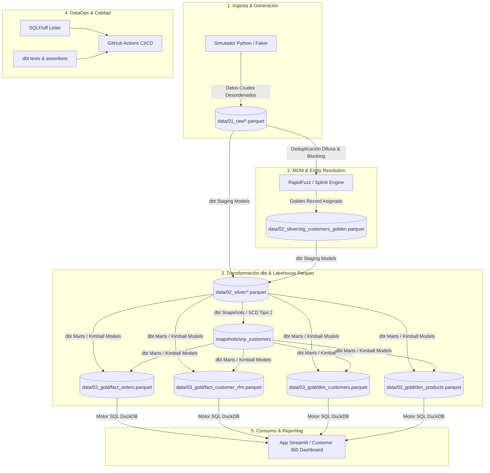

# ARGOS-360: E-Commerce Customer 360 & Operations Lakehouse

[](.github/workflows/ci.yml)
[](https://duckdb.org/)
[](https://www.getdbt.com/)
[](https://parquet.apache.org/)
[](app/dashboard.py)
[](https://sqlfluff.com/)

> **ARGOS-360** es una plataforma analítica **End-to-End** de estándar empresarial que implementa un **Open Data Lakehouse** sobre almacenamiento abierto Parquet y DuckDB. Resuelve el problema crítico de la fragmentación de identidades de clientes mediante **Master Data Management (MDM) y Entity Resolution probabilístico**, modela los datos bajo la metodología **Kimball (Esquema de Estrella + SCD Tipo 2)** y ofrece un cuadro de mando ejecutivo interactivo para la toma de decisiones estratégicas.

---

## Arquitectura End-to-End



---

## Características Técnicas Destacadas

### 1. Master Data Management (MDM) & Customer 360
* **Problema:** Múltiples fuentes (Shopify, Salesforce, HubSpot) generan identidades duplicadas por erratas tipográficas y variaciones de email.
* **Solución:** Motor de resolución de entidades con **reglas de bloqueo determinístico y matching probabilístico difuso** ($\ge 88\%$ similitud Levenshtein/Jaro-Winkler) agrupado mediante componentes conexos (*Disjoint-Set Union-Find*).
* **Resultado:** Creación de un **Golden Record** con `global_customer_id` único y trazabilidad completa hacia los registros de origen.

### 2. Open Data Lakehouse con Parquet Físico
* Todos los modelos de dbt utilizan la directiva `materialized='external'`, garantizando que las capas **Bronce (`01_raw`)**, **Plata (`02_silver`)** y **Oro (`03_gold`)** persistan físicamente como archivos `.parquet` abiertos en disco, eliminando cualquier dependencia propietaria.

### 3. Versionado Histórico (SCD Tipo 2) con dbt Snapshots
* Implementación nativa de **Slowly Changing Dimensions (SCD Tipo 2)** en `snapshots/snp_customers.sql` para rastrear cambios en domicilios y atributos de clientes sin alterar el histórico de ventas.

### 4. Modelado Dimensional Kimball & Segmentación RFM
* **`fact_orders`:** Hechos transaccionales con cálculo de márgenes netos, descuentos y tiempos de entrega.
* **`fact_customer_rfm`:** Motor de segmentación conductual **RFM (Recency, Frequency, Monetary)** clasificando a los clientes en *Champions, Loyal, Potential Loyalists, At Risk y Lost*.
* **`dim_customers`**, **`dim_products`**, **`dim_date`:** Dimensiones enriquecidas con jerarquías y categorías.

### 5. DataOps, Calidad y CI/CD
* Pipeline automatizado en **GitHub Actions (`.github/workflows/ci.yml`)** que ejecuta el linter de SQL (**SQLFluff**) y valida el 100% de los tests de calidad (**`dbt test`**) en cada *Pull Request*.

---

## Guía de Inicio Rápido (1 Comando)

### Prerrequisitos
* Python 3.10 o superior.

### 1. Clonar el Repositorio
```bash
git clone https://github.com/tu-usuario/argos-360.git
cd argos-360
```

### 2. Instalar Dependencias
```bash
make install
# O manualmente: pip install -r requirements.txt
```

### 3. Ejecutar la Pipeline Completa End-to-End
```bash
make pipeline
# O multiplataforma: python run_pipeline.py
```
> Este comando ejecuta la generación sintética, el motor de MDM, los snapshots de dbt, la compilación de la Capa Oro en Parquet y la batería de tests de calidad.

### 4. Lanzar el Dashboard Interactivo
```bash
make dashboard
# O directamente: streamlit run app/dashboard.py
```

---

## Estructura del Repositorio

```text
argos-360/
├── .github/workflows/ci.yml            # CI/CD: SQLFluff + dbt test
├── app/dashboard.py                    # Dashboard interactivo Streamlit
├── data/                               # Almacenamiento físico del Lakehouse
│   ├── 01_raw/*.parquet                # Capa Bronce
│   ├── 02_silver/*.parquet             # Capa Plata (Splink MDM & Staging)
│   └── 03_gold/*.parquet               # Capa Oro (Kimball Star Schema)
├── dbt_ecommerce/                      # Proyecto dbt
│   ├── dbt_project.yml                 # Configuración de dbt
│   ├── profiles.yml                    # Conexión DuckDB
│   ├── snapshots/snp_customers.sql     # SCD Tipo 2 dbt Snapshot
│   ├── models/
│   │   ├── staging/*.sql               # Modelos de limpieza Plata
│   │   └── marts/*.sql                 # Modelos Dimensionales Oro
│   └── tests/*.sql                     # Pruebas de aserción de calidad
├── docs/                               # Architecture Decision Records (ADRs)
│   ├── ADR_001_open_lakehouse_parquet.md
│   ├── ADR_002_splink_entity_resolution.md
│   └── ADR_003_dbt_scd2_snapshots.md
├── src/
│   ├── generator/generate_raw_data.py  # Generador de datos sintéticos
│   └── mdm/entity_resolution.py        # Motor de deduplicación y Golden Record
├── .sqlfluff                           # Configuración del linter SQL
├── Makefile                            # Orquestación con make
├── run_pipeline.py                     # Orquestación multiplataforma en Python
└── requirements.txt                    # Dependencias del proyecto
```
